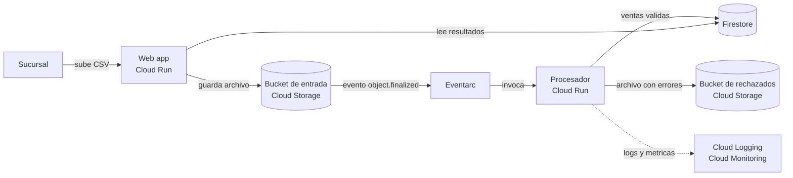

# MercaRed Perú S.A.C. — Pipeline serverless de ventas en Google Cloud

Proyecto final del curso **Servicios Cloud** (UTP) — **Opción B: Pipeline de ingesta y procesamiento de datos asíncrono serverless**.

MercaRed es una cadena ficticia de tiendas con sucursales en Lima. Cada sucursal envía un archivo CSV con sus ventas del día. Esta solución recibe esos archivos en Google Cloud, los valida y guarda las ventas en una base de datos de forma automática, sin servidores que administrar. Los archivos con errores se apartan y se notifica por correo cuando hay demasiados.

---

## Arquitectura



| Componente | Servicio de Google Cloud | Función |
|---|---|---|
| Página web | Cloud Run (`webapp`, pública) | Subir CSV y ver resultados por sucursal |
| Ingesta (data lake) | Cloud Storage (`mercared-entrada-*`) | Recibe los archivos de las sucursales |
| Eventos | Eventarc (+ Pub/Sub interno) | Detecta cada archivo nuevo y dispara el procesador |
| Procesamiento | Cloud Run (`procesador`, privado) | Valida filas y calcula totales; escala de 0 a 10 instancias |
| Persistencia | Firestore (modo nativo) | Colecciones `ventas` y `archivos` |
| Archivos con errores | Cloud Storage (`mercared-rechazados-*`) | Guarda los CSV rechazados para revisión |
| Red | VPC `mercared-vpc` + firewall | Tráfico privado de Cloud Run (Direct VPC egress) |
| Observabilidad | Cloud Logging + Cloud Monitoring | Métricas, dashboard y alertas por correo |

---

## Estructura del repositorio

```
mercared-pipeline/
├── README.md
├── config/                     # Políticas de ciclo de vida de los buckets
├── procesador/                 # Servicio que procesa los CSV (Python + Dockerfile)
├── webapp/                     # Página web (Python + Flask + Dockerfile)
├── monitoreo/                  # Alertas y dashboard (JSON generados por el script 05)
├── pruebas/                    # CSV de ejemplo (uno válido y uno con errores)
└── scripts/
    ├── 00-variables.sh         # Variables comunes (proyecto, región, nombres)
    ├── 01-red-y-permisos.sh    # APIs, VPC, firewall, cuentas de servicio e IAM
    ├── 02-almacenamiento.sh    # Firestore, buckets, ciclo de vida, IAM por bucket
    ├── 03-procesador.sh        # Cloud Run procesador + disparador Eventarc
    ├── 04-webapp.sh            # Cloud Run web app
    ├── 05-monitoreo.sh         # Métricas de logs, alertas y dashboard
    ├── 06-prueba-carga.sh      # Genera y sube muchos CSV para probar el autoescalado
    └── 99-eliminar-todo.sh     # Borra todos los recursos (usar al final)
```

---

## Cómo reproducir el despliegue

**Requisitos:** un proyecto de Google Cloud con facturación activa (la prueba gratuita sirve) y **Cloud Shell**, que ya trae `gcloud`, `git` y Python.

1. Abrir Cloud Shell y clonar el repositorio:
   ```bash
   git clone https://github.com/brendalescano4002/mercared-pipeline.git
   cd mercared-pipeline
   ```
2. Seleccionar el proyecto (y, si se desea, el correo para las alertas):
   ```bash
   gcloud config set project TU_PROJECT_ID
   export CORREO_ALERTAS=tu_correo@gmail.com
   ```
3. Ejecutar los scripts en orden:
   ```bash
   bash scripts/01-red-y-permisos.sh
   bash scripts/02-almacenamiento.sh
   bash scripts/03-procesador.sh
   bash scripts/04-webapp.sh      # al final muestra la URL de la página
   bash scripts/05-monitoreo.sh
   ```
   > Si el script 03 falla al crear el disparador con un error de permisos del *Eventarc Service Agent*, esperar 1–2 minutos (los permisos nuevos tardan en propagarse) y volver a ejecutar solo el comando `gcloud eventarc triggers create` del script.

4. Probar con los archivos de ejemplo:
   ```bash
   source scripts/00-variables.sh
   gcloud storage cp pruebas/*.csv gs://$BUCKET_ENTRADA/
   ```
   El archivo válido aparece como **procesado** en la página web y el archivo con errores pasa al bucket de rechazados.

5. Prueba de carga (autoescalado):
   ```bash
   bash scripts/06-prueba-carga.sh 150
   ```
   En el dashboard **"MercaRed - Pipeline de ventas"** de Cloud Monitoring se observa cómo el procesador sube de 1 a 10 instancias y luego vuelve a bajar.

---

## Formato del CSV

```
fecha,sucursal,producto,cantidad,precio_unitario
2026-11-25,Miraflores,Arroz 5kg,10,22.50
```

Reglas de validación: fecha `AAAA-MM-DD`, sucursal y producto obligatorios, cantidad entera mayor a 0, precio numérico no negativo. Si una sola fila falla, el archivo completo se rechaza y se registra el motivo.

---

## Red, puertos y seguridad

| Recurso | Valor |
|---|---|
| VPC | `mercared-vpc` (modo personalizado) |
| Subred | `subred-app` — `10.10.1.0/24` — `us-central1` — Private Google Access activado |
| Salida de Cloud Run | Direct VPC egress, solo rangos privados |
| Firewall `fw-permitir-interno` | Ingreso TCP/UDP/ICMP desde `10.10.0.0/16`, prioridad 1000 |
| Firewall `fw-denegar-ingreso-externo` | Deniega todo ingreso desde `0.0.0.0/0`, prioridad 65000 |
| Web app | HTTPS 443 público (URL de Cloud Run) |
| Procesador | HTTPS 443, **sin acceso público** (solo Eventarc con `run.invoker`) |
| Buckets | Acceso uniforme + prevención de acceso público |

### Cuentas de servicio y roles (menor privilegio)

| Cuenta de servicio | Rol | Alcance |
|---|---|---|
| `sa-webapp` | `roles/storage.objectCreator` | Bucket de entrada |
| `sa-webapp` | `roles/datastore.viewer` | Proyecto (solo lectura de Firestore) |
| `sa-procesador` | `roles/storage.objectAdmin` | Bucket de entrada |
| `sa-procesador` | `roles/storage.objectCreator` | Bucket de rechazados |
| `sa-procesador` | `roles/datastore.user` | Proyecto (lectura/escritura de Firestore) |
| `sa-eventarc` | `roles/eventarc.eventReceiver` | Proyecto |
| `sa-eventarc` | `roles/run.invoker` | Servicio `procesador` |

---

## Monitoreo y alertas

- **Métricas basadas en logs:** `archivos_procesados` y `archivos_rechazados`.
- **Alerta 1:** más de 3 archivos rechazados en 10 minutos → correo.
- **Alerta 2:** CPU del procesador mayor a 80 % durante 1 minuto → correo.
- **Dashboard:** instancias activas, procesados vs rechazados, solicitudes por código, latencia p95, CPU y visitas a la web.

---

## Limpieza

Después de la evaluación, para no consumir crédito:

```bash
bash scripts/99-eliminar-todo.sh
```

---

*Proyecto académico — Universidad Tecnológica del Perú.*
